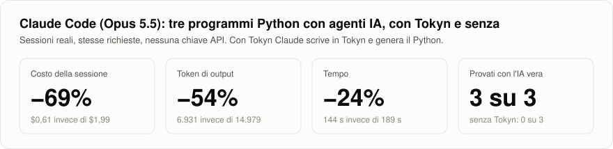
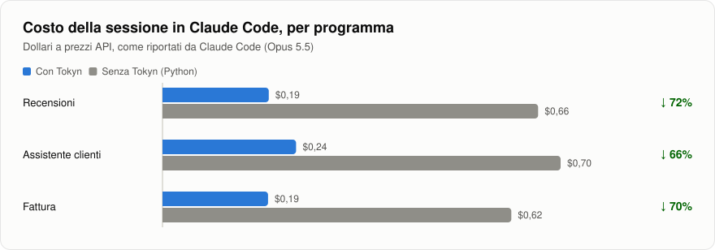
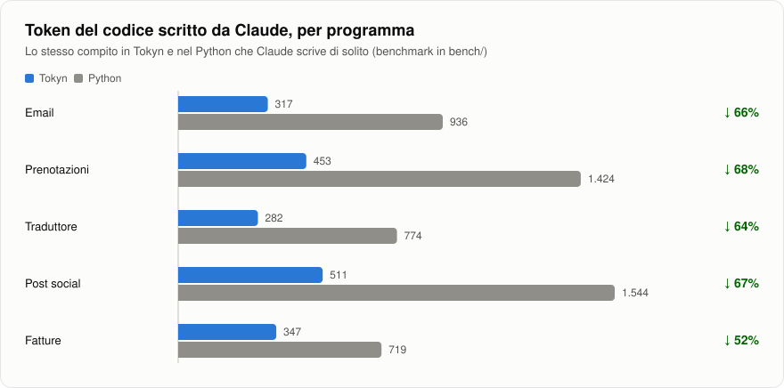

<div align="center">

# Tokyn

**Il linguaggio per agenti IA che Claude scrive al posto del Python:<br>meno token, meno costi, programmi provati davvero.**

[](https://github.com/DamianoCeka/tokyn/actions/workflows/test.yml)


</div>

<picture>
  <source media="(prefers-color-scheme: dark)" srcset="docs/grafici/numeri-dark.svg">
  
</picture>

Chiedi a Claude Code un programma con agenti IA, per esempio *"scrivimi in Python un bot che smista le email
dei clienti, usa tokyn"*. Claude lo scrive in **Tokyn**, un linguaggio con la sintassi di Python in cui agenti,
strumenti e output strutturati fanno già parte del linguaggio: servono molte meno righe, quindi molti meno token.
Poi lo prova con l'IA vera usando il tuo Claude Code, senza chiave API, e ti consegna il file Python.

## Installa in Claude Code

In una sessione di Claude Code:

```text
/plugin marketplace add DamianoCeka/tokyn
/plugin install tokyn@tokyn
```

Per la Skill in inglese, che costa il 22% di token in meno, installa `tokyn-en@tokyn`. Il plugin contiene il
compilatore: serve solo Python 3.10 o superiore (la libreria `lark`, se manca, la installa Claude).

## Come si usa

Chiedi il programma come faresti sempre, aggiungendo *"usa tokyn"*, oppure richiama la Skill con `/tokyn:tokyn`.
Claude:

1. **scrive il programma in Tokyn**, con circa un terzo dei token del Python;
2. **lo controlla e lo prova gratis** con risposte finte (`--mock`), correggendo gli errori che il compilatore
   gli spiega riga per riga;
3. **lo prova con l'IA vera** usando il tuo Claude Code: nessuna chiave API;
4. **ti dà il file Python**, generato dal compilatore con `tokyn build --standalone`. Quel codice non lo scrive il
   modello, quindi non costa token, ed è un file unico che non richiede Tokyn.

## Com'è un programma Tokyn

```
type Ticket:
    categoria: "tecnico" | "commerciale" | "altro"
    urgente: bool "True se il cliente è bloccato"

def cerca_faq(domanda: str) -> str:
    """Cerca una risposta nelle FAQ aziendali."""
    return read_file("faq.txt")

agent Supporto:
    instructions: "Rispondi ai clienti in italiano, in modo breve."
    tools: [cerca_faq]
    output: Ticket

main:
    t = Supporto.ask(input("Come posso aiutarti? "))
    if t.categoria == "tecnico" and t.urgente:
        print("Ti passo subito a un operatore.")
```

In Python lo stesso programma richiede il client dell'API, il ciclo delle chiamate agli strumenti, lo schema
JSON, il parsing e la validazione della risposta, i retry. In Tokyn è tutto dentro `Supporto.ask(...)`.

Quando qualcosa non va, il compilatore dice esattamente cosa correggere, così l'IA si corregge da sola:

```
supporto.tokyn:11:24 errore E133: lo strumento "prenota_appuntameto" non esiste
  11 |     tools: [cerca_faq, prenota_appuntameto]
     |                        ^^^^^^^^^^^^^^^^^^^
     → Forse intendevi "prenota_appuntamento"? Strumenti disponibili: cerca_faq, prenota_appuntamento
```

## I numeri

**In Claude Code, dal vivo.** Tre richieste di programmi Python con agenti IA a Claude Code (Opus 5.5), ognuna in
una sessione nuova, con il plugin Tokyn e senza. Nessuna chiave API, come succede a chi usa l'abbonamento.

<picture>
  <source media="(prefers-color-scheme: dark)" srcset="docs/grafici/costo-claude-code-dark.svg">
  
</picture>

| Programma | Costo con / senza Tokyn | Token di output con / senza | Provato con l'IA vera |
|---|---:|---:|---|
| Recensioni | $0,19 / $0,66 | 2.058 / 4.676 | con Tokyn sì, senza no |
| Assistente clienti | $0,24 / $0,70 | 2.881 / 5.701 | con Tokyn sì, senza no |
| Fattura | $0,19 / $0,62 | 1.992 / 4.602 | con Tokyn sì, senza no |

Senza Tokyn Claude ha scritto un Python corretto ma non ha potuto provarlo: senza chiave API il programma si ferma
all'autenticazione. Metodo, sorgenti e limiti in [`bench/claude-code/`](bench/claude-code).

**Il codice.** Gli stessi 5 programmi scritti da Claude in Tokyn e nel Python che scrive di solito:
**1.910 token contro 5.397 (−65%)**.

<picture>
  <source media="(prefers-color-scheme: dark)" srcset="docs/grafici/token-codice-dark.svg">
  
</picture>

Per onestà: con un framework come Pydantic AI il Python arriva più o meno agli stessi token di Tokyn. Il vantaggio
di Tokyn resta negli errori pensati per far correggere l'IA da sola, nella prova con il tuo Claude Code e nel
fatto che non dipende da quanto il modello ricorda l'API di un framework. Dettagli in [`bench/`](bench).

**L'IA lo sa scrivere.** Leggendo solo la Skill, Opus, Sonnet e Haiku hanno scritto 80 programmi in quattro
tornate, in italiano e in inglese: **80 su 80 corretti al primo tentativo**. Dettagli in [`eval/`](eval).

## Chi risponde agli agenti

Quando il programma gira, ogni `Agente.ask(...)` è una domanda a Claude. Tokyn sceglie da solo chi risponde:

- **Il tuo Claude Code**, se non c'è una chiave API: ogni domanda è una chiamata `claude -p` con il tuo account.
  È il modo per provare i programmi mentre li sviluppi.
- **L'API di Anthropic**, se c'è `ANTHROPIC_API_KEY`: per i programmi che girano da soli, per esempio su un server.
  Qui il runtime spende meno da solo, con prompt caching, output strutturati nativi, `Agente.ask_all(testi)` sulla
  Batch API a metà prezzo ed `effort: "low"` negli agenti che classificano o estraggono.

Si può forzare la scelta con `tokyn run file.tokyn --backend claude-code` (o `api`), e `--usage` mostra alla fine
i token spesi.

## Il linguaggio in breve

- **`agent`**: modello, istruzioni, strumenti, memoria, output strutturato, `effort`. Si usa con `Agente.ask(testo)`
  o, per tanti testi, `Agente.ask_all(testi)`.
- **`def`**: funzioni normali, che diventano strumenti quando le metti nei `tools` di un agente; gli argomenti che
  arrivano dall'IA vengono controllati con i tipi.
- **`type`**: dati strutturati, anche annidati, con valori ammessi (`"a" | "b"`) e descrizioni per l'IA.
- **Agenti come strumenti**: un agente può delegare a un altro.
- **Python ovunque**: `import` di qualsiasi libreria, slice, f-string, metodi di testi, liste e dizionari.
- **Valori di riserva al posto di `try`**: `read_file(p, "")`, `http_get(url, "")` e `to_number(testo, 0)` non
  fermano il programma se il file manca, la rete cade o il numero non è valido.
- **Errori pensati per l'IA**: alla riga del file `.tokyn`, con la correzione; se un modello scrive per abitudine
  una comprehension, `a if c else b` o `is None`, il compilatore dice cosa scrivere al loro posto.

La specifica completa è in [`tokyn/SPEC.md`](tokyn/SPEC.md), gli esempi in [`examples/`](examples).

## Da terminale

```bash
pip install git+https://github.com/DamianoCeka/tokyn
```

```bash
tokyn new primo                       # crea primo.tokyn
tokyn check primo.tokyn               # controlla e spiega gli errori
tokyn run primo.tokyn --mock          # prova senza chiamare l'IA (gratis)
tokyn run primo.tokyn --usage         # esegue davvero (Claude Code o ANTHROPIC_API_KEY)
tokyn build primo.tokyn --standalone  # genera un file Python che non richiede Tokyn
tokyn spec                            # stampa la specifica
```

Per Claude sul web c'è anche la Skill in zip: `python scripts/build_skill.py` crea `dist/tokyn-skill.zip` e
`dist/tokyn-skill-en.zip`, da caricare nelle impostazioni delle Skill.

## Come funziona

```
file.tokyn → parser (Lark) → checker (tipi, nomi, agenti) → generatore → Python → runtime (API o Claude Code)
```

- `tokyn/grammar.lark`: la grammatica
- `tokyn/checker.py`: i controlli e i messaggi d'errore
- `tokyn/codegen.py`: la traduzione in Python
- `tokyn/runtime.py`: agenti, ciclo degli strumenti, validazione, API di Anthropic e Claude Code
- `plugins/`: i plugin per Claude Code; `scripts/build_skill.py` ci copia il compilatore

I grafici di questa pagina si rigenerano dai dati con `python scripts/make_charts.py`.

## Dove sta andando

Tokyn è giovane ma funziona già: plugin per Claude Code in italiano e in inglese, agenti che rispondono con il tuo
Claude Code, 105 test. Le prossime tappe:

<table>
<tr>
<td width="50%" valign="top">

**Agenti in squadra**<br>
Più agenti al lavoro nello stesso momento, che si dividono un compito e si passano i risultati. Oggi un agente
può già delegare a un altro: il prossimo passo è farli lavorare in parallelo.

</td>
<td width="50%" valign="top">

**Anche in TypeScript**<br>
Lo stesso programma Tokyn compilato anche per Node e per il web: lo scrivi una volta e lo usi dove ti serve.

</td>
</tr>
<tr>
<td width="50%" valign="top">

**Da programma a servizio, con un comando**<br>
`tokyn serve`: l'agente che hai appena provato diventa un'API o un bot, pronto da mettere online.

</td>
<td width="50%" valign="top">

**Errori mentre scrivi**<br>
Un'estensione per VS Code con i colori di Tokyn e gli stessi errori che oggi guidano Claude, in tempo reale.

</td>
</tr>
</table>

## Licenza

MIT
